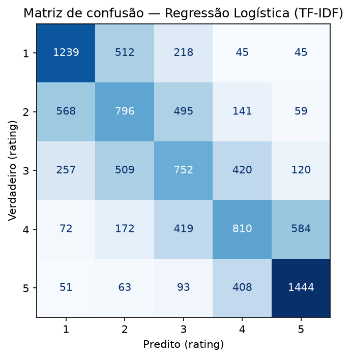
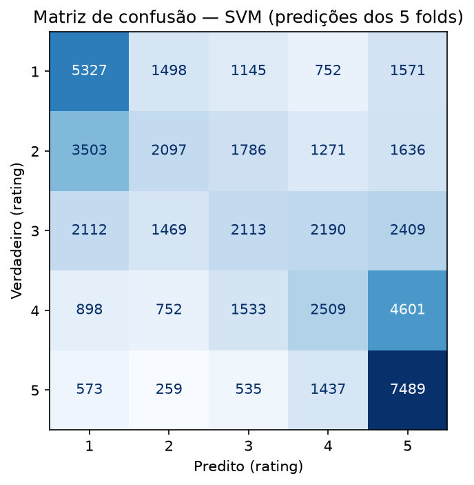
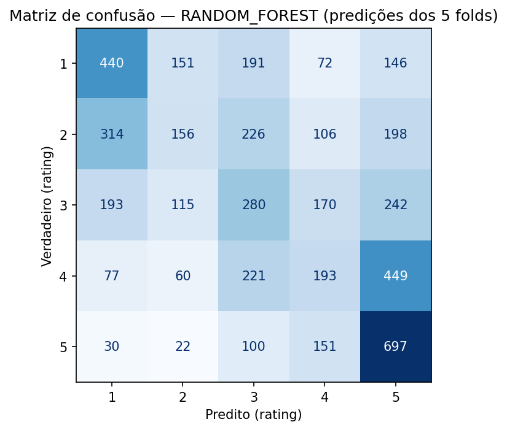
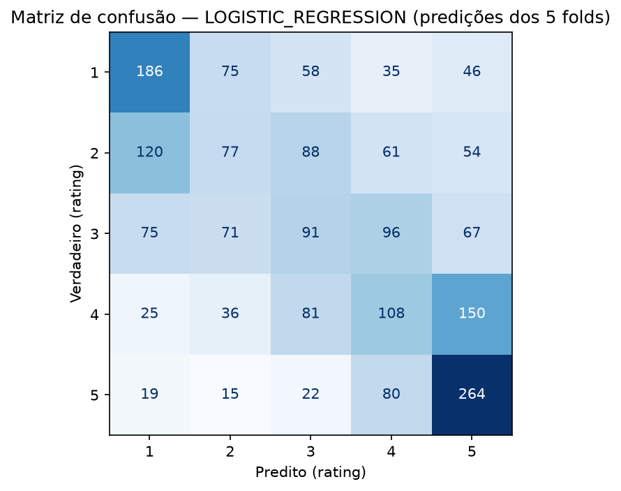

# Documentação do projeto

Este documento consolida o desenvolvimento da réplica do artigo *Rating Prediction in Brazilian Portuguese Reviews: An Approach Based on Textual Features* (Marreira, Oliveira e Melo). Ele atende à **TAREFA 15 / issue #11** e complementa:

- [`README.md`](../README.md): apresentação, ambiente e comandos;
- [`data/README.md`](../data/README.md): origem, splits e preparação dos dados;
- [`docs/features.md`](features.md): descrição detalhada das 58 features;
- [`docs/diferencas.md`](diferencas.md): registro contínuo das diferenças metodológicas;
- [`results/metrics/README.md`](../results/metrics/README.md): inventário dos artefatos de resultados.

**Estado de referência:** `main` no commit `d2d6ed6` (merge do PR #30, Gradient Boosting), em 2026-11-08. Os números deste documento vêm dos artefatos versionados nesse commit e dos registros de `docs/diferencas.md`; execuções rápidas não versionadas estão identificadas como tal.

> **Leia antes dos números.** Apenas o **SVM com as 58 features** foi executado no protocolo completo do artigo (5 folds sobre as 51.465 linhas). O Random Forest tem uma execução versionada em **amostra de 5.000 linhas com 1 candidato**; XGBoost e Gradient Boosting foram executados em **modo rápido** (2.000 linhas). Esses resultados não são comparáveis à Tabela 3 do artigo. Onde não houve execução, este documento registra **pendente**, sem apresentar números não verificados.

## Sumário

1. [Contexto e objetivos](#1-contexto-e-objetivos)
2. [Base de dados](#2-base-de-dados)
3. [As 58 features textuais](#3-as-58-features-textuais)
4. [Arquitetura e organização](#4-arquitetura-e-organização)
5. [Pré-processamento e normalização](#5-pré-processamento-e-normalização)
6. [Baseline TF-IDF + Regressão Logística](#6-baseline-tf-idf--regressão-logística)
7. [Protocolo compartilhado com as 58 features](#7-protocolo-compartilhado-com-as-58-features)
8. [Algoritmos avaliados](#8-algoritmos-avaliados)
9. [Métricas](#9-métricas)
10. [Resultados consolidados](#10-resultados-consolidados)
11. [Experimentos adicionais](#11-experimentos-adicionais)
12. [Diferenças em relação ao artigo](#12-diferenças-em-relação-ao-artigo)
13. [Perguntas de pesquisa](#13-perguntas-de-pesquisa)
14. [Limitações e pendências](#14-limitações-e-pendências)
15. [Reprodução](#15-reprodução)
16. [Referências](#16-referências)

---

## 1. Contexto e objetivos

### 1.1 O problema

**Rating prediction** é a tarefa de prever a nota (1 a 5 estrelas) que um usuário atribuiu a um produto a partir do texto da avaliação. É um problema de classificação multiclasse com classes ordinais, mas também pode ser lido como regressão, porque as notas são valores numéricos. A subjetividade do texto, a ironia, a mistura de elogios e críticas e a variação linguística tornam a tarefa difícil.

O projeto usa avaliações da **Amazon Brasil** escritas em português brasileiro. A entrada do modelo é o texto (ou features textuais dele); a saída é uma nota de 1 a 5.

### 1.2 Artigo de referência

O artigo propõe e avalia **58 features textuais** distribuídas em sete grupos: POS, padrões sintáticos, léxico, conceito (SenticNet), estruturais, Twitter/X e miscelânea. Os autores comparam cinco algoritmos — SVM, Random Forest, Logistic Regression, Gradient Boosting Trees e XGBoost — em uma validação cruzada de 5 folds estratificada por categoria e rating. O XGBoost foi o melhor modelo nas três métricas principais (MAE, RMSE e AUC) e foi escolhido para as análises seguintes.

As quatro perguntas de pesquisa do artigo são:

| Pergunta | O que investiga | Resposta publicada no artigo |
| --- | --- | --- |
| **PP1** | Qual algoritmo tem melhor desempenho em rating prediction usando apenas features textuais, por categoria? | XGBoost teve as menores MAE/RMSE e a maior AUC; superou LR e SVM e não diferiu estatisticamente de GBT e RF. |
| **PP2** | Existe um grupo de features mais relevante? | O grupo **LEX** (léxico) foi o mais relevante; POS e CONC vieram em seguida. |
| **PP3** | Como a combinação das features impacta o desempenho? | Com RFE, o melhor resultado foi com **todas as 58 features**; a feature mais relevante foi F27 (palavras negativas). |
| **PP4** | A melhor configuração mantém o desempenho em diferentes categorias? | **Moda** teve o melhor desempenho e **Livros** o pior; vocabulários mais homogêneos facilitam a tarefa. |

### 1.3 Objetivo da réplica

A réplica tem três objetivos:

1. **Reproduzir** o protocolo e os resultados da RQ1 do artigo com as 58 features, começando pelo SVM e avançando para Random Forest, Gradient Boosting e XGBoost.
2. **Documentar** as decisões, os experimentos, os resultados e as diferenças em relação ao artigo.
3. **Explorar experimentos adicionais** da equipe, em especial o baseline **TF-IDF + Regressão Logística**, o estudo de normalização textual e a comparação entre TF-IDF e as 58 features.

### 1.4 O que foi reproduzido e o que é adicional

| Item | Artigo | Réplica | Situação |
| --- | --- | --- | --- |
| Base e splits | 51.465 avaliações, 10 categorias, classes balanceadas | CSVs oficiais do projeto original, mesmos totais | Reproduzido |
| 58 features | Extraídas com spaCy, SenticNet, Hunspell e SentiProdBR | Colunas pré-calculadas dos CSVs | Reutilizado, sem reextração |
| SVM com 58 features | 5 folds, busca por RMSE, MAE/RMSE/AUC | Protocolo completo; resultados praticamente idênticos | **Reproduzido** |
| Random Forest com 58 features | 5 folds, busca por RMSE | Implementado; execução versionada é uma amostra de 5.000 linhas | **Parcial** |
| Gradient Boosting com 58 features | 5 folds, busca por RMSE | Implementado; apenas modo rápido (2.000 linhas) | **Parcial** |
| XGBoost com 58 features | 5 folds, busca por RMSE | Implementado; apenas modo rápido (2.000 linhas) | **Parcial** |
| Regressão Logística com 58 features | 5 folds, linha da Tabela 3 | Implementada; **modo rápido** (amostra de 2.000, Colab e local); execução completa pendente | **Parcial** |
| TF-IDF + Regressão Logística | Citado apenas como trabalho futuro | Baseline completo, validação 80/20 e teste oficial | **Adicional** |
| Normalização textual | Não descrita no artigo | Sete variantes avaliadas | **Adicional** |
| Comparação TF-IDF × 58 features | Não existe no artigo | SVM completo; RF/XGB/GBT em modo rápido ou amostra | **Adicional** |
| Métricas de acurácia e F1 macro | Não usadas | Calculadas em todos os modelos | **Adicional** |
| Holdout `train.csv` → `test.csv` | O teste participa da validação cruzada | Avaliação complementar separada | **Adicional** |
| PP2, PP3 e PP4 | Ablation, RFE e análise por categoria | Não executadas | **Pendente** |

---

## 2. Base de dados

### 2.1 Origem

Os dados são avaliações de produtos da **Amazon Brasil** em português brasileiro. O artigo relata coleta manual e por *web scraping* entre 2021 e 2024. A réplica **não coleta dados**: usa os arquivos `train.csv` e `test.csv` distribuídos pelo repositório original do artigo, que já contêm os splits oficiais e as 58 features calculadas.

- Repositório original: [github.com/emanuellemarreira/rating-prediction-with-textual-features](https://github.com/emanuellemarreira/rating-prediction-with-textual-features).
- Licença: **não especificada** pelo projeto de origem. O uso deve ser restrito a fins acadêmicos/educacionais; os CSVs não são versionados e não devem ser redistribuídos.
- Forma de obtenção: download direto dos CSVs do repositório original, sem scraping próprio.

### 2.2 Arquivos e splits

| Arquivo | Linhas | Proporção | Papel |
| --- | ---: | ---: | --- |
| `data/raw/train.csv` | 41.172 | 80% | Treino oficial |
| `data/raw/test.csv` | 10.293 | 20% | Teste oficial |
| **Total** | **51.465** | **100%** | |

O `data/raw/validation.csv` (8.235 linhas) é um recorte local de 20% do treino, gerado por `scripts/create_validation_split.py` para o experimento de validação 80/20 do baseline. Ele **não** é um split do artigo e não é versionado.

### 2.3 Estrutura das colunas

Cada CSV tem **61 colunas**:

- `categoria`: categoria do produto (10 valores);
- `text`: texto bruto da avaliação;
- `rating`: nota de 1 a 5 (alvo);
- 58 features textuais: 7 `str_*`, 19 `pos_*`, 5 `synt_*`, 10 `lex_*`, 10 `conc_*`, 5 `twt_*` e 2 `sbj_*`.

Os dois arquivos têm as mesmas colunas, na mesma ordem. As 58 features não têm valores ausentes. Há exatamente **1 texto vazio no treino e 1 no teste**.

### 2.4 Distribuição dos ratings

As classes estão **balanceadas** nos dois splits (o artigo aplicou *undersampling* antes de distribuí-los):

| Rating | Treino | Teste | Total |
| ---: | ---: | ---: | ---: |
| 1 | 8.234 | 2.059 | 10.293 |
| 2 | 8.234 | 2.059 | 10.293 |
| 3 | 8.235 | 2.058 | 10.293 |
| 4 | 8.235 | 2.058 | 10.293 |
| 5 | 8.234 | 2.059 | 10.293 |
| **Total** | **41.172** | **10.293** | **51.465** |

### 2.5 Categorias de produto

As categorias são desbalanceadas entre si, como no artigo: Livros e Moda concentram mais avaliações; Computadores e Pets, menos. Os totais por categoria conferem exatamente com a Tabela 1 do artigo.

| Categoria no CSV | Nome no artigo | Treino | Teste | Total |
| --- | --- | ---: | ---: | ---: |
| `auto` | Automotivo | 3.490 | 875 | 4.365 |
| `baby` | Bebê | 4.230 | 1.055 | 5.285 |
| `celular` | Celulares | 3.469 | 866 | 4.335 |
| `food` | Alimentos | 2.968 | 742 | 3.710 |
| `games` | Jogos | 4.870 | 1.215 | 6.085 |
| `laptops` | Computadores | 740 | 185 | 925 |
| `livros` | Livros | 9.035 | 2.260 | 11.295 |
| `moda` | Moda | 5.770 | 1.445 | 7.215 |
| `pets` | Pets | 1.780 | 445 | 2.225 |
| `toys` | Brinquedos | 4.820 | 1.205 | 6.025 |
| **Total** | | **41.172** | **10.293** | **51.465** |

### 2.6 Balanceamento e undersampling

O artigo relata *undersampling* aleatório das classes majoritárias (4 e 5 estrelas) para igualá-las às minoritárias (1, 2 e 3). Os CSVs distribuídos já refletem esse balanceamento: cada rating tem cerca de 8.234–8.235 linhas no treino e 2.058–2.059 no teste.

**Não foi necessário aplicar undersampling adicional na réplica.** Nenhuma linha foi removida por balanceamento. A única remoção no baseline TF-IDF é a de **1 texto vazio por split**; o protocolo das 58 features mantém essas duas linhas, porque as features já estão calculadas.

O desbalanceamento **entre categorias** permanece e é uma característica do conjunto, não um defeito do split.

### 2.7 Carregamento e preparação

Há dois caminhos de carregamento:

| Caminho | Código | Colunas lidas | Tratamento |
| --- | --- | --- | --- |
| Baseline TF-IDF | `src/preprocessing/embedding.py`, `run_baseline.py` | `text`, `rating` | normaliza o texto e remove vazios (`empty="drop"`); codifica o rating em 0..4 |
| Protocolo das 58 features | `src/models/article_protocol.py` | todas as 61 | seleciona as 58 features, valida colunas, mantém textos vazios, codifica o rating em 0..4 e cria a chave `categoria_rating` para estratificar |

No protocolo, `categoria`, `text` e `rating` **nunca** entram na matriz `X`. Uma coluna inesperada — como um índice `Unnamed: 0` ou um `id` — interrompe a execução em vez de entrar no modelo em silêncio. A categoria é usada apenas para estratificar os folds e para análises futuras por categoria.

### 2.8 Duplicatas entre treino e teste

A auditoria encontrou **280 combinações distintas** de (`categoria`, `text`, `rating`) presentes nos dois splits, correspondendo a **351 ocorrências** no total (um mesmo texto pode aparecer mais de uma vez em cada split). Cerca de 41 combinações são reviews longas e específicas, não apenas textos genéricos como "Ok" ou "10".

**Decisão da réplica:** manter o split oficial sem alteração. Remover duplicatas mudaria a base do artigo e invalidaria a comparação direta; além disso, o artigo não discute o problema. A limitação fica registrada: o modelo pode ter visto no treino exemplos do teste, o que tende a **inflar** as métricas. Todos os resultados devem ser lidos com essa ressalva.

Também existem duplicatas dentro de cada split (949 linhas repetidas no treino e 104 no teste, além da primeira ocorrência), mas elas não foram tratadas.

### 2.9 Limitações da base

- Licença não especificada e ausência dos dados brutos de coleta.
- Duplicatas entre treino e teste (280 combinações / 351 ocorrências).
- Desbalanceamento entre categorias.
- 1 texto vazio por split.
- 58 features pré-calculadas, sem código de extração no repositório.
- O artigo não disponibiliza os JSONs brutos; a réplica usa apenas os CSVs processados.

---

## 3. As 58 features textuais

### 3.1 O que são

Features textuais são medidas extraídas do texto que representam propriedades linguísticas, estruturais ou de sentimento. Em vez de entregar o texto cru ao modelo, o artigo calcula 58 números por avaliação. A motivação é tornar o problema interpretável e barato: os modelos tradicionais recebem vetores densos de 58 dimensões, em vez de dezenas de milhares de termos do TF-IDF.

### 3.2 Os sete grupos

| Grupo | Prefixo | Quantidade | O que mede |
| --- | --- | ---: | --- |
| **POS** — Part-of-speech | `pos_` | 19 | Contagem de cada classe gramatical (adjetivo, advérbio, artigo, conjunção, interjeição, pontuação, número, partícula, preposição, pronome, nome próprio, símbolo, substantivo, superlativo, verbo, auxiliar, comparativo, token desconhecido). |
| **SYNT** — Padrões sintáticos | `synt_` | 5 | Ocorrência de padrões como Adjetivo → Substantivo, Advérbio → Adjetivo → Não-Substantivo, Advérbio → Verbo. |
| **LEX** — Léxico | `lex_` | 10 | Termos subjetivos, palavras positivas/negativas, pontuação expressiva, frases positivas/negativas e proporções, com o léxico SentiProdBR. |
| **CONC** — Conceito | `conc_` | 10 | Somas e médias de *pleasantness*, *sensitivity*, *aptitude*, *attention* e polaridade geral, do SenticNet. |
| **EST** — Estruturais | `str_` | 7 | Caracteres, palavras, frases, palavras/letras maiúsculas e proporções. |
| **TWT** — Twitter/X | `twt_` | 5 | Palavras alongadas, gírias, negações, emojis e emoticons com pontuação de sentimento. |
| **MCL** — Miscelânea | `sbj_` | 2 | Entidades nomeadas (spaCy) e palavras escritas corretamente (Hunspell). |

A descrição detalhada de cada uma das 58 features, com o número F1–F58, o nome da coluna e a definição, está em [`docs/features.md`](features.md).

### 3.3 Seleção e exclusão

O protocolo usa a função `select_feature_columns` (`src/models/article_protocol.py`):

- aceita apenas colunas com os prefixos `str_`, `pos_`, `synt_`, `lex_`, `conc_`, `twt_` e `sbj_`;
- exige exatamente 58 features;
- permite `categoria`, `text` e `rating` no DataFrame, mas não em `X`;
- levanta `ValueError` para qualquer coluna extra.

As features são convertidas para `float64`; valores ausentes interrompem a execução. **Não há padronização**, como no artigo. As escalas variam de proporções entre 0 e 1 a contagens que chegam a milhares (`str_qtcharacters`), o que deixa o SVM mais lento e pode prejudicar o kernel RBF.

### 3.4 Features pré-calculadas, não reextraídas

A réplica **reutiliza as 58 colunas dos CSVs**. Não há código de extração no repositório, e o pipeline original (spaCy, scikit-learn, SenticNet, Hunspell, SentiProdBR) não é reproduzido. Consequências:

- não é possível auditar as features nem verificar versões das bibliotecas de NLP;
- os resultados dependem da qualidade da extração do projeto original;
- se a equipe reextrair as features no futuro, deve usar o **texto bruto**, nunca o texto normalizado do baseline, porque a normalização remove maiúsculas, alongamentos, emojis/emoticons e pontuação usados por várias features.

### 3.5 Esparsidade

Comentários curtos produzem muitos zeros. No artigo, isso motivou a escolha de modelos que lidam bem com dados esparsos. Na réplica, a matriz de 58 features é densa em formato, mas esparsa em conteúdo; não foi aplicada redução de dimensionalidade nem seleção de features na RQ1.

---

## 4. Arquitetura e organização

### 4.1 Estrutura do repositório

```text
.
├── .github/                      # Templates de issue e pull request
├── data/
│   ├── raw/                      # train.csv, test.csv, validation.csv (não versionados)
│   ├── processed/                # TF-IDF e artefatos gerados (não versionados)
│   └── README.md                 # Origem, splits, colunas e preparação
├── docs/
│   ├── documentacao.md           # Este documento
│   ├── features.md               # As 58 features em detalhe
│   └── diferencas.md             # Decisões e diferenças em relação ao artigo
├── notebooks/
│   ├── auditoria_dados.ipynb     # Análise exploratória dos textos
│   ├── baseline_logreg_colab.ipynb
│   ├── baseline_logreg_validation_colab.ipynb
│   └── logistic_regression_rq1_colab.ipynb
├── results/
│   ├── figures/                  # Matrizes de confusão (PNG)
│   ├── metrics/                  # JSON/CSV versionados
│   └── sample/                   # Execuções rápidas (não versionado)
├── scripts/                      # Pontos de entrada executáveis
├── src/
│   ├── data/splitting.py
│   ├── preprocessing/{normalization,encoding,embedding}.py
│   ├── models/{article_protocol,baseline,svm,random_forest,xgboost,gradient_boosting}.py
│   ├── evaluation/{metrics,plots}.py
│   └── utils/
├── tests/                        # Testes automatizados (pytest)
├── .coveragerc
├── .gitignore
├── pytest.ini
├── requirements.txt
├── run_baseline.py               # Pipeline fim a fim do baseline
├── README.md
└── RatingPredictionInBrazilianPortugueseReviews.pdf
```

### 4.2 Responsabilidade dos módulos

| Módulo | Responsabilidade |
| --- | --- |
| `src/data/splitting.py` | Split estratificado treino/validação por rating, com remoção de textos vazios. |
| `src/preprocessing/normalization.py` | Normalização leve do texto: minúsculas, repetições, abreviações, acentos, pontuação e números opcionais. |
| `src/preprocessing/encoding.py` | Label encoding reversível do rating (1..5 → 0..4) e chave `categoria_rating`. |
| `src/preprocessing/embedding.py` | TF-IDF com `fit` apenas no treino, transformação do teste, persistência e estatísticas. |
| `src/models/article_protocol.py` | Harness compartilhado do protocolo do artigo: carga, folds, busca, métricas, IC, holdout e artefatos. |
| `src/models/baseline.py` | Regressão Logística sobre TF-IDF. |
| `src/models/svm.py` | `SVM_SPEC` (grid do artigo) e comparação SVM + TF-IDF. |
| `src/models/random_forest.py` | `RANDOM_FOREST_SPEC` (grid do artigo) e comparação RF + TF-IDF. |
| `src/models/xgboost.py` | `XGB_SPEC` (grid da TAREFA 14) e comparação XGB + TF-IDF. |
| `src/models/gradient_boosting.py` | `GRADIENT_BOOSTING_SPEC` (grid da TAREFA 13) e comparação GBT + TF-IDF. |
| `src/evaluation/metrics.py` | Acurácia, F1 macro, MAE e RMSE na escala de estrelas. |
| `src/evaluation/plots.py` | Matrizes de confusão em PNG. |
| `src/utils/` | Reservado para funções auxiliares; atualmente contém apenas `__init__.py`, sem código de produção. |

### 4.3 Scripts

| Script | O que faz |
| --- | --- |
| `scripts/check_environment.py` | Importa as dependências principais e imprime versões; falha se faltar algo. |
| `scripts/create_validation_split.py` | Gera `data/raw/validation.csv` com 20% do treino, estratificado por rating. |
| `scripts/train_baseline.py` | Treina LR + TF-IDF no split oficial e salva métricas, modelo e matriz de confusão. |
| `scripts/train_baseline_validation.py` | Treina LR em 80% do treino e avalia nos 20% de validação, sem tocar no teste. |
| `scripts/compare_normalization.py` | Compara sete variantes de normalização com o mesmo TF-IDF + LR. |
| `scripts/train_article_model.py` | CLI do protocolo do artigo para `svm`, `random_forest`, `xgboost` e `gradient_boosting`. |
| `scripts/train_svm_tfidf.py` | SVM sobre TF-IDF e comparação com a LR do baseline. |
| `scripts/train_random_forest_tfidf.py` | Random Forest sobre TF-IDF e comparação com a LR. |
| `scripts/train_xgboost_tfidf.py` | XGBoost sobre TF-IDF e comparação com a LR. |
| `scripts/train_gradient_boosting_tfidf.py` | Gradient Boosting sobre TF-IDF e comparação com a LR. |
| `run_baseline.py` | Pipeline fim a fim do baseline: normalização → encoding → TF-IDF → LR → avaliação. |

### 4.4 Fluxos de execução

**Baseline TF-IDF + LR**

```text
train.csv/test.csv
  → normalize_dataframe (texto; remove 1 vazio por split)
  → encode_rating (1..5 → 0..4)
  → TfidfVectorizer.fit_transform(treino) / transform(teste)
  → LogisticRegression
  → accuracy, F1 macro, MAE, RMSE, matriz de confusão
```

**Protocolo do artigo (58 features)**

```text
train.csv + test.csv concatenados (51.465 linhas)
  → select_feature_columns (58 features; categoria/text/rating fora de X)
  → StratifiedKFold(5, shuffle=False) por categoria_rating
  → RandomizedSearchCV (RMSE, seed 42, refit=False)
  → refit do melhor estimador em cada fold
  → métricas por fold + média/desvio/IC 95%
  → holdout train.csv → test.csv (mesmos hiperparâmetros)
  → JSON, CSV por fold, JSON de holdout e matriz de confusão OOF
```

**Comparações complementares TF-IDF**

Cada script `train_<modelo>_tfidf.py` reaproveita a matriz TF-IDF da Issue 6, treina no `train.csv` e avalia no `test.csv`. As comparações com a LR só são gravadas na base completa; no modo rápido (`--sample-n`), ficam `null`.

### 4.5 Armazenamento dos resultados

| Caminho | Conteúdo | Versionado? |
| --- | --- | --- |
| `results/metrics/*.json` | Configuração, métricas, melhores parâmetros e comparações | Sim, para os artefatos completos e para o RF em amostra |
| `results/metrics/*_folds.csv` | Métricas por fold | Sim, para SVM e RF |
| `results/figures/confusion_matrix_*.png` | Matrizes de confusão | Sim, para LR, SVM e RF |
| `results/sample/` | Saídas de `--sample-n` / modo rápido | **Não** |
| `data/processed/` | TF-IDF, rótulos, vetorizador e modelo | **Não** |
| `data/raw/` | CSVs originais | **Não** |

O `.gitignore` tem uma *whitelist* para os artefatos oficiais de SVM, XGBoost e Gradient Boosting; o modo rápido sempre grava em `results/sample/` e não sobrescreve os resultados completos.

### 4.6 Testes automatizados

A suíte fica em `tests/` e usa `pytest` (configuração em `pytest.ini`; cobertura em `.coveragerc`). As principais finalidades:

| Área | Testes |
| --- | --- |
| Normalização | `test_normalization.py`, `test_normalizacao_casos_reais.py` |
| Label encoding | `test_encoding.py`, `test_encoding_dados_reais.py` |
| TF-IDF | `test_embedding.py`, `test_tfidf_reuso.py` |
| Métricas e baseline | `test_metrics.py`, `test_metricas_valores_conhecidos.py`, `test_baseline.py`, `test_plots.py` |
| Split e reprodutibilidade | `test_splitting.py`, `test_reprodutibilidade.py`, `test_create_validation_split.py` |
| Protocolo e CLI | `test_article_protocol.py`, `test_article_protocol_dados_reais.py`, `test_train_article_model.py` |
| Modelos da RQ1 | `test_svm.py`, `test_random_forest.py`, `test_xgboost.py`, `test_gradient_boosting.py` |
| Comparação de normalização | `test_compare_normalization.py` |
| Baseline e validação | `test_train_baseline.py`, `test_train_baseline_validation.py` |
| Notebooks Colab | `test_colab_notebook.py`, `test_colab_validation_notebook.py` |
| Ambiente | `test_environment.py` |

Comandos:

```bash
python -m pytest
python -m pytest --cov --cov-fail-under=80
```

Testes que leem `data/raw/train.csv` são **pulados** se o arquivo não existir. Os demais usam CSVs sintéticos e rodam em qualquer máquina.

### 4.7 Bibliotecas e ambiente

| Biblioteca | Versão fixada | Uso |
| --- | ---: | --- |
| Python | 3.12+ | Ambiente (validado em Linux e Windows nos PRs) |
| `numpy` | 2.5.3 | Álgebra numérica |
| `pandas` | 3.0.6 | Leitura e manipulação dos CSVs |
| `scikit-learn` | 1.9.1 | TF-IDF, modelos, busca, métricas e folds |
| `xgboost` | 3.4.1 | XGBoost |
| `scipy` | 1.18.1 | Matrizes esparsas e distribuição t |
| `matplotlib` | 3.11.2 | Matrizes de confusão |
| `jupyter` | 1.1.1 | Notebooks |
| `pytest` | 9.1.1 | Testes |
| `pytest-cov` | 7.1.0 | Cobertura |
| `nltk` | 3.10.3 | Declarado para experimentos de NLP; **não é usado** pela normalização atual |
| `joblib` | via scikit-learn | Persistência de modelos e paralelismo |

Observações de ambiente:

- Os artefatos do SVM e do XGBoost foram gerados com scikit-learn **1.9.1**; o artefato versionado do Random Forest foi gerado com **1.8.0**.
- O artigo usa `scikit-learn-intelex` (Intel oneDAL) no SVM; a réplica usa scikit-learn puro, o que pode produzir pequenas diferenças numéricas.
- A normalização atual usa apenas a biblioteca padrão (`re`, `unicodedata`); o `nltk` está em `requirements.txt` para experimentos futuros e não é necessário para reproduzir os resultados atuais.

---

## 5. Pré-processamento e normalização

### 5.1 Papel da normalização

A normalização é usada **apenas no baseline TF-IDF**. O protocolo das 58 features não normaliza o texto: as features já vêm calculadas e o artigo não descreve uma etapa de normalização. Isso é uma diferença importante: o texto normalizado não é a entrada dos modelos da RQ1.

### 5.2 `normalize()`

A função `normalize` em `src/preprocessing/normalization.py` é pura, idempotente e não altera a entrada. A ordem das operações é:

1. normalização Unicode NFC e conversão para minúsculas;
2. colapso de caracteres repetidos: 3 ou mais repetições viram 2 (`ameiii` → `ameii`), exceto dígitos (`1000` permanece);
3. expansão de abreviações comuns: `vc`, `vcs`, `pq`, `eh`, `tb`, `tbm`, `q`, `tá`;
4. remoção de acentos (`não` → `nao`), preservando seletores de variação de emoji;
5. opcionalmente, troca de pontuação por espaço;
6. opcionalmente, troca de números por um token (`NUM`);
7. colapso de espaços e remoção de espaços nas pontas.

Entradas `None`, `NaN` ou não-string viram `""`. `normalize_dataframe` aplica a função a uma coluna e trata vazios com `empty="drop"` (padrão do baseline) ou `empty="fill"`.

### 5.3 As sete configurações avaliadas

`scripts/compare_normalization.py` treina **o mesmo modelo** (TF-IDF com os parâmetros padrão + LR com `C=1.0`, seed 42) em sete variantes que diferem apenas no pré-processamento:

| Variante | O que faz |
| --- | --- |
| `sem_normalizacao` | Texto bruto; só o tratamento padrão do `TfidfVectorizer` (`lowercase`, `strip_accents="unicode"`). É a referência. |
| `normalizacao_completa` | `normalize()` com os padrões do projeto. |
| `apenas_acentos` | Só remoção de acentos. |
| `apenas_repeticoes` | Só colapso de repetições. |
| `apenas_abreviacoes` | Só expansão de abreviações. |
| `completa_sem_pontuacao` | Normalização completa + pontuação trocada por espaço. |
| `completa_numero_token` | Normalização completa + números trocados por `NUM`. |

Cuidados metodológicos:

- **Mesmas linhas em todas as variantes.** Textos que ficam vazios após a normalização completa são removidos também na variante bruta (41.171 linhas de treino e 10.292 de teste).
- **Dois protocolos.** *Validação*: 80% do treino → 20% de validação (8.235 linhas), sem tocar no teste; é a base da decisão. *Teste*: treino completo → teste oficial, apenas confirmação.
- **Bootstrap pareado** (1.000 reamostragens, seed 42) no conjunto de avaliação: o mesmo sorteio de linhas é aplicado a todas as variantes, e o IC 95% da diferença em relação à referência indica se ela se distingue de zero.

### 5.4 Resultados na validação (base da decisão)

Δ = variante − `sem_normalizacao`. Para acurácia e F1, maior é melhor; para MAE e RMSE, menor é melhor.

| Variante | Acurácia | F1 macro | MAE | RMSE | Vocab. | Δ acurácia | Δ MAE | Sig. acc | Sig. MAE |
| --- | ---: | ---: | ---: | ---: | ---: | ---: | ---: | :---: | :---: |
| `sem_normalizacao` | 0,4865 | 0,4830 | 0,7022 | 1,0914 | 23.330 | +0,0000 | +0,0000 | ref | ref |
| `normalizacao_completa` | 0,4866 | 0,4833 | 0,7001 | 1,0883 | 23.332 | +0,0001 | −0,0022 | não | não |
| `apenas_acentos` | 0,4865 | 0,4830 | 0,7022 | 1,0914 | 23.330 | +0,0000 | +0,0000 | não | não |
| `apenas_repeticoes` | 0,4860 | 0,4827 | 0,7013 | 1,0895 | 23.327 | −0,0005 | −0,0010 | não | não |
| `apenas_abreviacoes` | 0,4866 | 0,4832 | 0,6993 | 1,0865 | 23.335 | +0,0001 | −0,0029 | não | não |
| `completa_sem_pontuacao` | 0,4865 | 0,4831 | 0,7007 | 1,0891 | 23.332 | +0,0000 | −0,0016 | não | não |
| `completa_numero_token` | 0,4839 | 0,4804 | 0,7052 | 1,0948 | 23.304 | −0,0026 | +0,0029 | não | não |

### 5.5 Resultados no teste oficial (confirmação)

| Variante | Acurácia | F1 macro | MAE | RMSE | Vocab. | Δ acurácia | Δ MAE | Sig. acc | Sig. MAE |
| --- | ---: | ---: | ---: | ---: | ---: | ---: | ---: | :---: | :---: |
| `sem_normalizacao` | 0,4903 | 0,4866 | 0,6824 | 1,0633 | 28.488 | +0,0000 | +0,0000 | ref | ref |
| `normalizacao_completa` | 0,4888 | 0,4851 | 0,6836 | 1,0639 | 28.500 | −0,0015 | +0,0013 | não | não |
| `apenas_acentos` | 0,4903 | 0,4866 | 0,6824 | 1,0633 | 28.488 | +0,0000 | +0,0000 | não | não |
| `apenas_repeticoes` | 0,4912 | 0,4875 | 0,6798 | 1,0602 | 28.487 | +0,0009 | −0,0025 | não | sim |
| `apenas_abreviacoes` | 0,4889 | 0,4854 | 0,6831 | 1,0627 | 28.501 | −0,0014 | +0,0007 | não | não |
| `completa_sem_pontuacao` | 0,4894 | 0,4857 | 0,6823 | 1,0623 | 28.500 | −0,0009 | −0,0001 | não | não |
| `completa_numero_token` | 0,4896 | 0,4857 | 0,6840 | 1,0661 | 28.450 | −0,0007 | +0,0017 | não | não |

As tabelas completas, os ICs do bootstrap e a análise estão em [`docs/diferencas.md`](diferencas.md), seção 2. Os arquivos versionados são `results/metrics/normalization_comparison_validation.json` e `normalization_comparison.json` (configuração e ICs do bootstrap). As tabelas `.csv` e `.md` são geradas localmente pelo script e não são versionadas.

### 5.6 Discussão

**A normalização não tem efeito mensurável neste baseline.** A maior diferença de acurácia em módulo é 0,0026 (validação) e 0,0015 (teste), e o IC 95% da diferença tem meia-largura de ≈0,002 a 0,003. Nenhuma diferença de acurácia ou F1 se distingue de zero em qualquer variante, em qualquer protocolo.

**O sinal da normalização completa muda de lado entre os protocolos** (Δ acurácia +0,0001 na validação e −0,0015 no teste). É o comportamento esperado de ruído, não de um efeito real.

**Variações desse tamanho também aparecem entre execuções do mesmo código.** O JSON do baseline registra acurácia de 0,4898 para a configuração equivalente à `normalizacao_completa`; reexecutada no experimento de comparação, a mesma configuração deu 0,4888. A causa não foi investigada (hipótese: diferenças numéricas do solver entre plataformas). Por isso todas as variantes devem ser comparadas **na mesma execução**, e não contra números versionados em outra máquina.

**`apenas_acentos` é idêntico à referência** em todas as métricas e no vocabulário (23.330 e 28.488 termos), porque o `TfidfVectorizer` já remove acentos (`strip_accents="unicode"`). A etapa altera 78,7% dos textos, mas é redundante para o TF-IDF.

**`completa_sem_pontuacao` não muda o vocabulário** em relação à `normalizacao_completa` (28.500 termos nos dois casos), apesar de alterar 91,9% dos textos: o `token_pattern` padrão do TF-IDF só reconhece sequências de 2+ caracteres alfanuméricos, então a pontuação já é ignorada. Além disso, trocar pontuação por espaço desfaz emoticons.

**O único resultado "significativo" não se sustenta.** No teste, `apenas_repeticoes` reduz o MAE em 0,0025 com IC que exclui zero, mas na validação a mesma variante dá ΔMAE = −0,0010 com IC que contém zero, e a acurácia cai 0,0005. Foram 12 comparações sem correção para múltiplos testes, o que torna esperado ≈0,6 falso positivo ao nível de 5%. Tratamos como acaso.

**Por que o efeito é pequeno.** As etapas tocam poucos textos: repetições alteram 7,8% do treino e abreviações 3,9%; o vocabulário muda menos de 0,1% (28.488 → 28.500 termos). Essa explicação é uma interpretação, não foi testada isoladamente.

**`completa_numero_token`** é a única variante com sinal consistentemente desfavorável: pior acurácia na validação (−0,0026, IC [−0,0058; +0,0007]) e sem ganho no teste. O IC contém zero, então não é conclusivo, mas não há motivo para adotá-la.

### 5.7 Decisão

1. **Manter a normalização atual no baseline** (minúsculas, repetições, abreviações, espaços), sem alterar o código. Não há evidência de benefício nem de prejuízo; manter evita invalidar resultados, notebooks e testes já versionados, e as etapas têm justificativa linguística. A escolha é por custo de mudança, **não por ganho medido**.
2. **Não ativar `strip_punctuation`**: não tem efeito sobre o TF-IDF e desfaz emoticons.
3. **Não ativar `number_token`**: sem benefício e com sinal desfavorável na validação.
4. **Considerar `strip_accent` redundante** com o TF-IDF. Pode permanecer no código, mas não deve ser citado como contribuição da normalização.
5. **Não investir mais tempo ajustando a normalização** para o TF-IDF: ela não é uma alavanca de desempenho neste modelo.
6. **Para as 58 features, usar o texto bruto**, nunca o normalizado, se houver reextração. A recomendação vem da leitura das definições do artigo e não foi testada empiricamente.

A alternativa de adotar `sem_normalizacao` como baseline (mais simples) é igualmente defensável pelos dados; a equipe deve confirmar a escolha na revisão do Pull Request.

### 5.8 Limitações da normalização

- Um único modelo (LR) e uma única configuração de TF-IDF; o efeito pode ser diferente com outros classificadores ou representações.
- Uma única seed e um único split; o bootstrap mede a incerteza da amostra de avaliação, não a do treino.
- Duplicatas entre treino e teste podem atenuar diferenças.
- Sem correção para múltiplas comparações; os ICs são individuais.
- A coluna `tempo_s` dos CSVs varia a cada execução; as demais são determinísticas no mesmo ambiente.

---

## 6. Baseline TF-IDF + Regressão Logística

### 6.1 O que é TF-IDF

TF-IDF (*Term Frequency–Inverse Document Frequency*) transforma cada comentário em um vetor esparso. Cada posição corresponde a um termo (ou par de termos) do vocabulário. O peso combina:

- **TF**: frequência do termo no documento (aqui com `sublinear_tf=True`, que aplica escala logarítmica);
- **IDF**: logaritmo do número de documentos dividido pelo número de documentos que contêm o termo, o que reduz o peso de termos muito comuns.

O vocabulário e o IDF são aprendidos **somente no treino**. O teste só é transformado, evitando vazamento de dados.

### 6.2 Configuração do vetorizador

| Parâmetro | Valor |
| --- | --- |
| `lowercase` | `True` |
| `strip_accents` | `"unicode"` |
| `ngram_range` | `(1, 2)` |
| `min_df` | `5` |
| `max_df` | `0.95` |
| `sublinear_tf` | `True` |

Na base completa, o vocabulário tem **28.500 termos**. A matriz de treino tem 41.171 documentos e esparsidade de 99,91%; a de teste, 10.292 documentos e 99,91%. Em média, cada documento tem cerca de 25 termos não nulos.

### 6.3 Separação treino/teste

O baseline usa os splits oficiais: `train.csv` para ajustar o vetorizador e a LR; `test.csv` apenas para transformar e avaliar. As 58 features **não** entram. O texto é normalizado e **1 linha vazia é removida de cada split**, resultando em 41.171 e 10.292 linhas.

### 6.4 Regressão Logística

| Hiperparâmetro | Valor |
| --- | --- |
| `C` | `1.0` |
| `max_iter` | `1000` |
| `solver` | `lbfgs` |
| `random_state` | `42` |

O modelo é multinomial e produz probabilidades por classe; a predição é a classe de maior probabilidade.

### 6.5 Resultados no teste oficial

| Modelo | Acurácia | F1 macro | MAE (estrelas) | RMSE (estrelas) |
| --- | ---: | ---: | ---: | ---: |
| Regressão Logística + TF-IDF | 0,4898 | 0,4862 | 0,6819 | 1,0619 |
| Classe majoritária (baseline trivial) | 0,2000 | 0,0667 | 1,2002 | 1,4144 |

A LR supera com folga o baseline trivial, mas a acurácia em torno de 49% mostra que a tarefa é difícil: o modelo confunde principalmente classes vizinhas. As métricas estão em `results/metrics/baseline_logreg.json`; a matriz de confusão, em `results/figures/confusion_matrix_logreg.png`. Esses são os artefatos versionados gerados por `scripts/train_baseline.py`. O `run_baseline.py` executa o mesmo pipeline, mas grava `baseline_metrics.json` e `baseline_confusion_matrix.png` (prefixo diferente), além do modelo e das previsões em `data/processed/`.

### 6.6 Validação 80/20

O experimento de validação separa 20% do `train.csv` (8.235 linhas) e treina nos 80% restantes (32.936 linhas), sem usar o teste oficial.

| Métrica | Treino completo → teste oficial | Treino 80% → validação | Validação − teste |
| --- | ---: | ---: | ---: |
| Acurácia | 0,4898 | 0,4860 | −0,0038 |
| F1 macro | 0,4862 | 0,4827 | −0,0035 |
| MAE (estrelas) | 0,6819 | 0,7004 | +0,0185 |
| RMSE (estrelas) | 1,0619 | 1,0879 | +0,0260 |

As métricas são próximas. O modelo de validação treinou com menos dados, então a diferença não é uma comparação perfeitamente equivalente. Arquivos: `results/metrics/baseline_logreg_validation.json`, `baseline_logreg_comparison.csv` e `results/figures/confusion_matrix_logreg_validation.png`.

### 6.7 Reprodutibilidade

Com a mesma seed, os mesmos CSVs e as mesmas versões das dependências, duas execuções geram as mesmas métricas. Comandos:

```bash
python run_baseline.py                    # base completa
python run_baseline.py --sample-size 2000 # execução rápida
python scripts/train_baseline_validation.py
```

---

## 7. Protocolo compartilhado com as 58 features

O protocolo está em `src/models/article_protocol.py` e é usado por SVM, Random Forest, XGBoost e Gradient Boosting. A CLI é `scripts/train_article_model.py`.

### 7.1 Dados

- `train.csv` + `test.csv` concatenados, nessa ordem: **51.465 linhas**.
- Apenas as 58 features entram em `X`; `categoria`, `text` e `rating` ficam fora.
- Nenhuma linha é removida, nem as de `text` vazio (2 linhas).
- A categoria é usada para montar a chave `categoria_rating` (50 grupos) e estratificar os folds.

**O teste participa da validação cruzada**, como no código original do artigo. Isso significa que as métricas de CV não são de dados nunca vistos. O holdout complementar (treino no `train.csv`, avaliação no `test.csv`) existe para dar uma leitura fora-da-amostra, mas não substitui o protocolo do artigo.

### 7.2 Folds

- `StratifiedKFold(n_splits=5, shuffle=False)`, estratificado por `categoria_rating`.
- A ordem das linhas (treino, depois teste) define os folds. `--shuffle` existe, mas fica registrado no JSON e não é o padrão.
- Cada fold tem 41.172 linhas de treino e 10.293 de teste (80/20 do total), o que coincidentemente é o mesmo tamanho dos splits oficiais, mas **não é o split oficial**.

### 7.3 Busca de hiperparâmetros

- `RandomizedSearchCV` com `scoring="neg_root_mean_squared_error"`.
- `random_state=42`; `n_iter=300` por padrão.
- `refit=False` na busca: o melhor modelo não é reajustado em todos os dados ao final, porque cada fold é retreinado separadamente (o artigo reajusta, mas não usa esse modelo).
- O número real de candidatos avaliados é registrado em `n_candidates_evaluated`. Se o grid tiver menos combinações que `n_iter`, o scikit-learn avalia todas (caso do SVM: 16).

### 7.4 Avaliação por fold

Para cada fold, o melhor estimador é clonado, treinado no treino do fold e avaliado no teste do fold. As métricas são:

- MAE e RMSE na escala de 1 a 5 estrelas;
- F1 macro e acurácia nas classes 0..4;
- AUC do artigo: classes 4 e 5 são positivas, calculada a partir das **predições binárias**;
- AUC de diagnóstico (`auc_scores`): a partir de `decision_function` ou `predict_proba`, dependendo do modelo.

Também são geradas as predições fora-da-dobra (*out-of-fold*) e uma matriz de confusão 5×5 agregada.

### 7.5 Agregação e intervalo de confiança

- Média e desvio-padrão (`ddof=1`) entre os 5 folds.
- Erro-padrão e IC 95% pela distribuição t de Student com **4 graus de liberdade**.
- O IC usa apenas os 5 valores dos folds. O código original do artigo anexa a linha da média antes de calcular o IC, o que usa 6 valores e 5 graus de liberdade e produz um IC cerca de **24% mais estreito**. Média e desvio não são afetados. A réplica usa o IC correto; a comparação com o artigo deve ser feita pela média e pelo desvio.

### 7.6 Holdout complementar

Com os mesmos hiperparâmetros encontrados na busca, o modelo é treinado em todo o `train.csv` e avaliado no `test.csv` oficial. O tamanho e as métricas ficam em `<modelo>_rq1_holdout.json`. Esse holdout é uma leitura adicional, não o protocolo do artigo.

### 7.7 Reprodutibilidade

- Seed 42 na busca, na amostragem e nos estimadores.
- `--n-jobs -1` usa todos os núcleos; o resultado não depende do número de jobs.
- O `--sample-n` usa uma amostra estratificada por `categoria_rating` que preserva a ordem das linhas; o modo rápido grava em `results/sample/`.
- Os JSONs registram a versão do scikit-learn, os parâmetros, o número de candidatos e os tempos.

### 7.8 Grids

| Modelo | Dimensões do grid | Combinações | `n_iter` padrão | `n_iter` no modo rápido |
| --- | --- | ---: | ---: | ---: |
| SVM | `C` (2) × `kernel` (2) × `gamma` (4) | 16 | 300 (avalia 16) | 300 |
| Random Forest | 8 dimensões: 5 × 4 × 3 × 3 × 4 × 3 × 3 × 3 | 19.440 | 300 | 10 |
| XGBoost | 9 dimensões: 4 × 3⁸ | 26.244 | 300 | 20 |
| Gradient Boosting | 6 dimensões: 5 × 4 × 3 × 3 × 3 × 4 | 2.160 | 300 | 5 |

### 7.9 Artefatos por modelo

Para `<m>` = `svm`, `random_forest`, `xgboost` ou `gradient_boosting`:

| Arquivo | Conteúdo |
| --- | --- |
| `results/metrics/<m>_rq1.json` | Configuração, melhores parâmetros, médias/desvios/ICs, comparação com a Tabela 3 |
| `results/metrics/<m>_rq1_folds.csv` | Métricas de cada fold |
| `results/metrics/<m>_rq1_holdout.json` | Treino em `train.csv`, avaliação em `test.csv` |
| `results/figures/confusion_matrix_<m>.png` | Matriz de confusão OOF |

No modo rápido, os mesmos arquivos vão para `results/sample/`.

### 7.10 Limitações do protocolo

- O teste participa da validação cruzada, como no artigo; as métricas de CV são otimistas.
- As 58 features não são padronizadas; o SVM é sensível a escala e lento.
- O grid do SVM tem apenas 16 combinações e `gamma` não afeta o kernel linear; há candidatos redundantes.
- `n_iter=300` é inviável para alguns grids em máquinas comuns; XGBoost e Gradient Boosting usaram modo rápido.
- O Random Forest versionado usou uma amostra de 5.000 linhas e 1 candidato, não o grid completo.
- A comparação com o artigo deve ser feita pela média e pelo desvio, não pelo IC publicado.

---

## 8. Algoritmos avaliados

### 8.1 SVM

**Como funciona:** o `SVC` busca uma fronteira que maximiza a margem entre as classes. O parâmetro `C` controla o compromisso entre margem larga e erros de treino (valores menores = mais regularização). O kernel `linear` usa o produto interno original; o `rbf` usa uma similaridade gaussiana cujo alcance é controlado por `gamma`. O artigo não padroniza as features, o que penaliza o RBF e deixa o SVM lento.

**Implementação:** `src/models/svm.py`, `SVC` do scikit-learn, sem padronização.

**Grid:** `C` ∈ {0,01; 0,1}, `kernel` ∈ {linear, rbf}, `gamma` ∈ {scale, auto, 0,01; 0,1} = 16 combinações. `n_iter=300` avalia todas as 16.

**Melhores parâmetros:** `kernel=linear`, `gamma=scale`, `C=0.1` — os mesmos do artigo (segundo o código original).

**Execução completa:** 51.465 linhas, 5 folds, 16 candidatos, scikit-learn 1.9.1, `--n-jobs -1`.

| Métrica | Artigo (Tabela 3) | Réplica | Δ da média | IC 95% da réplica |
| --- | --- | --- | ---: | --- |
| MAE | 1,0431 ± 0,0070 | 1,0430 ± 0,0062 | −0,0001 | [1,0353; 1,0506] |
| RMSE | 1,5085 ± 0,0118 | 1,5085 ± 0,0112 | +0,00003 | [1,4947; 1,5224] |
| AUC | 0,7304 ± 0,0046 | 0,7303 ± 0,0047 | −0,0001 | [0,7246; 0,7361] |

Outras métricas: F1 macro 0,3550 ± 0,0023; acurácia 0,3796 ± 0,0020; AUC por scores 0,8000 ± 0,0046.

**Holdout:** MAE 1,0476; RMSE 1,5160; F1 macro 0,3539; acurácia 0,3791; AUC 0,7295; AUC por scores 0,7999.

**Tempos:** busca 27.355,86 s (≈7,6 h); avaliação 969,36 s (≈16 min). O tempo depende do número de núcleos.

**Leitura:** a réplica reproduz o artigo; as médias diferem em no máximo 0,00014. O desvio-padrão da réplica é um pouco menor, possivelmente por diferenças numéricas do scikit-learn puro vs. `scikit-learn-intelex` e pelo arredondamento por fold no artigo. O holdout fica dentro da faixa dos folds.

### 8.2 Random Forest

**Como funciona:** o Random Forest treina muitas árvores de decisão em amostras *bootstrap* e, em cada divisão, considera apenas um subconjunto aleatório de features (`max_features`). A predição final é a votação majoritária das árvores. `n_estimators` define o número de árvores; `max_depth`, `min_samples_split`, `min_samples_leaf`, `max_leaf_nodes` e `min_impurity_decrease` controlam o crescimento; `class_weight` lida com desbalanceamento; `max_features` controla a aleatoriedade e a correlação entre árvores.

**Implementação:** `src/models/random_forest.py`, `RandomForestClassifier` com `random_state=42` e `n_jobs=1`.

**Grid:** `n_estimators` (5) × `max_depth` (4) × `min_samples_split` (3) × `min_samples_leaf` (3) × `max_features` (4) × `class_weight` (3) × `max_leaf_nodes` (3) × `min_impurity_decrease` (3) = **19.440 combinações**. `n_iter=300` no protocolo.

**Diferença em relação ao artigo:** o script original usa `random_state=None`; a réplica fixa `random_state=42` para reprodutibilidade. O artigo não informa os melhores hiperparâmetros (`ARTICLE_BEST_PARAMS` vazio).

**Estado da execução:** o único artefato versionado (`results/metrics/random_forest_rq1.json`) registra:

- `sample_n=5000`, `n_rows=5000`, `n_train_csv_rows=4034`, `n_test_csv_rows=966`;
- `n_iter_requested=1`, `n_candidates_evaluated=1`;
- um `param_grid` com **um único valor por hiperparâmetro**, que não corresponde ao grid de 19.440 combinações;
- scikit-learn **1.8.0**.

Portanto, **esse artefato não é a execução completa do protocolo**. Ele serve como uma execução de amostra/smoke test, e o comando que o gerou não está registrado. A execução completa do Random Forest **continua pendente**. O número de folds no CSV (`n_train=4000`, `n_test=1000`) confirma que a validação cruzada foi feita sobre as 5.000 linhas da amostra.

Métricas da amostra (não comparáveis à Tabela 3):

| Métrica | Média ± desvio | IC 95% |
| --- | --- | --- |
| MAE | 1,0784 ± 0,0200 | [1,0536; 1,1032] |
| RMSE | 1,5165 ± 0,0296 | [1,4797; 1,5532] |
| AUC | 0,7168 ± 0,0110 | [0,7032; 0,7304] |
| Acurácia | 0,3532 ± 0,0122 | [0,3381; 0,3683] |
| F1 macro | 0,3300 ± 0,0157 | [0,3105; 0,3495] |
| AUC por scores | 0,7925 ± 0,0101 | [0,7800; 0,8050] |

**Holdout da amostra:** MAE 1,1087; RMSE 1,5407; F1 macro 0,3131; acurácia 0,3375; AUC 0,7150; AUC por scores 0,7867.

**Tempos da amostra:** busca 0,22 s; avaliação 0,28 s (com 1 candidato). Não são representativos do protocolo completo.

**Comparação RF + TF-IDF (amostra de 5.000):** `results/metrics/random_forest_tfidf.json` registra MAE 0,8088; RMSE 1,2487; F1 macro 0,4458; acurácia 0,4568; AUC 0,7867; AUC por scores 0,8647; 28.500 features; `n_iter=1`; 8,96 s; scikit-learn 1.8.0. Não há comparação com a LR porque o modo rápido não a grava.

**Leitura:** os números do RF **não devem ser comparados** ao artigo nem ao SVM completo. A execução completa precisa ser refeita com o grid de 19.440 combinações e `n_iter=300`.

### 8.3 XGBoost

**Como funciona:** o XGBoost é um *gradient boosting* regularizado. As árvores são construídas sequencialmente: cada nova árvore tenta corrigir os resíduos das anteriores. `reg_alpha` (L1) e `reg_lambda` (L2) penalizam a complexidade, `gamma` exige um ganho mínimo para criar uma divisão, `min_child_weight` limita o peso mínimo por folha, e `subsample`/`colsample_bytree` amostram linhas e colunas. `learning_rate` encolhe a contribuição de cada árvore e `n_estimators` define quantas são adicionadas. O `tree_method` padrão `hist` usa histogramas para acelerar o treino.

**Implementação:** `src/models/xgboost.py`, `XGBClassifier` com `random_state=42`, `n_jobs=1`; o paralelismo fica no `RandomizedSearchCV`/`n_jobs` externo. `tree_method` padrão `hist` no xgboost 3.x.

**Grid:** `n_estimators` (4) × `learning_rate`, `max_depth`, `min_child_weight`, `gamma`, `subsample`, `colsample_bytree`, `reg_alpha`, `reg_lambda` (3 cada) = **26.244 combinações**. `n_iter=300` no protocolo.

**Estado da execução:** a execução completa foi iniciada e interrompida após ~40 min por restrição de hardware; nenhum artefato parcial foi gravado. A entrega usou o **modo rápido** `--sample-n 2000 --n-iter 20`, com 2.000 linhas (1.587 de treino e 413 de teste) e 20 candidatos × 5 folds. Os artefatos estão em `results/sample/` e **não são versionados**; os números estão em [`docs/diferencas.md`](diferencas.md), seção 4.

**Melhores parâmetros no modo rápido:** `n_estimators=300`, `max_depth=10`, `learning_rate=0.1`, `subsample=1.0`, `colsample_bytree=0.4`, `gamma=0.0`, `reg_alpha=0.1`, `reg_lambda=1`, `min_child_weight=1`.

| Métrica | Artigo (Tabela 3) | Réplica *modo rápido* | Δ da média |
| --- | --- | --- | ---: |
| MAE | 0,9499 ± 0,0047 | 1,0215 ± 0,0327 | +0,0716 |
| RMSE | 1,3721 ± 0,0055 | 1,4337 ± 0,0490 | +0,0616 |
| AUC | 0,7390 ± 0,0046 | 0,7204 ± 0,0306 | −0,0186 |

Outras métricas do modo rápido: F1 macro 0,3485 ± 0,0178; acurácia 0,3535 ± 0,0153; AUC por scores 0,8027 ± 0,0185.

**Holdout do modo rápido:** MAE 1,0508; RMSE 1,4159; F1 macro 0,3005; acurácia 0,3075; AUC 0,7518; AUC por scores 0,8194.

**Tempos:** busca 26,6 s e avaliação 4,4 s no modo rápido (≈9 núcleos). A execução completa foi estimada em ~3 h de busca, mas **não foi concluída**, então a estimativa não é verificada.

**Comparação XGB + TF-IDF (modo rápido):** MAE 0,9420; RMSE 1,3409; F1 macro 0,3734; acurácia 0,3740; AUC 0,7267; AUC por scores 0,8174; 2.000/500 linhas; 28.500 features; 8 candidatos; 378,33 s (≈6,3 min). Sem comparação com a LR no modo rápido.

**Leitura:** o desvio entre folds no modo rápido (≈0,03–0,05) é 7–9× o do artigo (≈0,005), como esperado com 1/26 dos dados. As diferenças em relação à Tabela 3 não são comparáveis; o protocolo completo continua pendente.

### 8.4 Gradient Boosting

**Como funciona:** o Gradient Boosting treina árvores sequencialmente; cada árvore é ajustada ao gradiente negativo da função de perda (resíduos) do modelo atual. `learning_rate` controla a contribuição de cada árvore, `n_estimators` o número de etapas, e `max_depth`, `min_samples_split`, `min_samples_leaf` e `max_features` controlam a complexidade. No scikit-learn multiclasse, cada etapa adiciona uma árvore por classe.

**Implementação:** `src/models/gradient_boosting.py`, `GradientBoostingClassifier` (subclasse que usa `predict_proba` na AUC de diagnóstico), `random_state=42`.

**Grid:** `n_estimators` (5) × `learning_rate` (4) × `max_depth` (3) × `min_samples_split` (3) × `min_samples_leaf` (3) × `max_features` (4) = **2.160 combinações**. `n_iter=300` no artigo; a réplica permite configurar.

**Estado da execução:** apenas **modo rápido** `--sample-n 2000 --n-iter 5`, com 5 candidatos × 5 folds e 1.587/413 linhas no holdout. Os artefatos estão em `results/sample/` e **não são versionados**; os números estão em [`docs/diferencas.md`](diferencas.md), seção 5.

**Melhores parâmetros no modo rápido:** `n_estimators=100`, `max_depth=5`, `learning_rate=0.01`, `min_samples_split=10`, `min_samples_leaf=1`, `max_features=None`.

| Métrica | Artigo (Tabela 3) | Réplica *modo rápido* | Δ da média |
| --- | --- | --- | ---: |
| MAE | 0,9612 ± 0,0061 | 1,0400 ± 0,0549 | +0,0788 |
| RMSE | 1,3727 ± 0,0051 | 1,4527 ± 0,0584 | +0,0800 |
| AUC | 0,7318 ± 0,0058 | 0,7072 ± 0,0133 | −0,0246 |

IC 95% do modo rápido: MAE [0,9718; 1,1082], RMSE [1,3801; 1,5252], AUC [0,6907; 0,7237]. Acurácia e F1 macro do modo rápido não foram registrados no texto; estariam nos JSON não versionados.

**Holdout do modo rápido:** MAE 1,0726; RMSE 1,4901; AUC 0,7422.

**Tempos:** modo rápido de 2 a 3 min em 1 núcleo (menos com `--n-jobs -1`). A execução completa não foi feita; uma estimativa grosseira, por extrapolação, é da ordem de 20 minutos por candidato em 1 núcleo — **não verificada**.

**Comparação GBT + TF-IDF (modo rápido):** acurácia 0,3860; F1 macro 0,3839; MAE 0,9260; RMSE 1,3364; AUC 0,7333; AUC por probabilidades 0,8316; 2.000/500 linhas; 28.500 features; 6 candidatos, 3 folds; 36,0 s. Sem comparação com a LR no modo rápido.

**Leitura:** o desvio-padrão entre folds é 9–11× o do artigo. As médias do artigo ficam um pouco fora do IC do modo rápido nas três métricas, o que é coerente com menos dados e apenas 5 candidatos; não permite afirmar equivalência nem refutar o artigo. O protocolo completo continua pendente.

### 8.5 Regressão Logística

**Como funciona:** a Regressão Logística modela a probabilidade de cada classe com a função *softmax* (multinomial) e minimiza a entropia cruzada com regularização L2 controlada por `C`. O solver `lbfgs` é um otimizador quasi-Newton determinístico dado o mesmo ponto de partida; `max_iter` limita as iterações. A predição é a classe de maior probabilidade.

A LR aparece em dois papéis:

1. **Baseline da réplica:** LR + TF-IDF, com `C=1.0`, `max_iter=1000`, `solver=lbfgs`, seed 42. Resultados completos na seção 6. **Não é a LR do artigo**, que usa as 58 features.
2. **Linha da Tabela 3 do artigo:** LR com as 58 features, MAE 1,0149 ± 0,0043, RMSE 1,4691 ± 0,0042, AUC 0,7328 ± 0,0064. Na réplica, essa configuração só existe no **modo rápido** (amostra de 2.000, `docs/diferencas.md` §7); a execução completa — comparável — continua pendente.

### 8.6 Resumo das execuções e tempos

| Modelo | Representação | Execução | Status | Tempo |
| --- | --- | --- | --- | --- |
| LR | TF-IDF | Completa, holdout oficial | Concluída | Segundos (PR #20: 7,5 s) |
| SVM | 58 features | Completa, 5 folds | Concluída | ≈7,6 h de busca + ≈16 min de avaliação |
| SVM | TF-IDF | Completa, holdout oficial | Concluída | ≈10 min em 1 núcleo |
| Random Forest | 58 features | Amostra 5.000, 1 candidato | Parcial | <1 s (amostra) |
| Random Forest | TF-IDF | Amostra 5.000, 1 candidato | Parcial | 9,0 s |
| XGBoost | 58 features | Modo rápido 2.000, 20 candidatos | Parcial | ≈31 s |
| XGBoost | TF-IDF | Modo rápido 2.000, 8 candidatos | Parcial | 378,3 s |
| Gradient Boosting | 58 features | Modo rápido 2.000, 5 candidatos | Parcial | 2–3 min |
| Gradient Boosting | TF-IDF | Modo rápido 2.000, 6 candidatos | Parcial | 36,0 s |

---

## 9. Métricas

### 9.1 MAE

\[
\mathrm{MAE} = \frac{1}{N}\sum_{i=1}^{N} |y_i - \hat{y}_i|
\]

Mede o erro absoluto médio em estrelas. É interpretável na escala original: MAE 1,0 significa, em média, errar 1 estrela. Valores menores são melhores.

### 9.2 RMSE

\[
\mathrm{RMSE} = \sqrt{\frac{1}{N}\sum_{i=1}^{N} (y_i - \hat{y}_i)^2}
\]

Também está em estrelas, mas penaliza mais os erros grandes por elevar as diferenças ao quadrado. Foi o critério de otimização dos hiperparâmetros no artigo e na réplica. Valores menores são melhores.

### 9.3 AUC

A AUC mede a capacidade de separar duas classes ao longo de todos os limiares da curva ROC. No artigo, as classes **4 e 5 estrelas** são positivas e **1, 2 e 3** são negativas. A AUC do artigo (`auc`) é calculada a partir das **predições binárias**, não de scores contínuos; isso equivale a \((\text{sensibilidade} + \text{especificidade})/2\). Valores próximos de 1 são melhores.

Como diagnóstico, a réplica calcula `auc_scores` a partir de scores contínuos:

- `decision_function` para SVM;
- `predict_proba` para Gradient Boosting (por exigência da TAREFA 13) e para modelos que só expõem probabilidades;
- para o XGBoost, `predict_proba` também é usado como diagnóstico.

A AUC por scores tende a ser maior que a AUC por predições binárias, porque usa mais informação. As duas **não são intercambiáveis** e não devem ser comparadas diretamente.

### 9.4 Acurácia e F1 macro

- **Acurácia**: fração de acertos entre as 5 classes.
- **F1 macro**: média harmônica de precisão e recall por classe, sem ponderação pelo tamanho da classe. É útil porque todas as classes têm o mesmo tamanho; um F1 macro baixo indica que o modelo não está acertando as classes de forma equilibrada.

Essas métricas **não estão na Tabela 3 do artigo**; são um adicional da réplica.

### 9.5 Matriz de confusão

A matriz 5×5 mostra, para cada nota verdadeira, quantas vezes o modelo previu cada nota. No protocolo das 58 features, a matriz é montada com as predições **fora-da-dobra** dos 5 folds; no baseline, com as predições no teste oficial. As figuras ficam em `results/figures/`.

### 9.6 Agregação entre folds

Para cada métrica:

- média dos 5 folds;
- desvio-padrão com `ddof=1`;
- erro-padrão;
- IC 95% pela distribuição t com 4 graus de liberdade.

O IC da réplica é mais largo que o publicado no artigo, porque o artigo inclui a média como sexto valor (5 graus de liberdade). A média e o desvio não mudam. **Compare com o artigo pela média e pelo desvio, não pelo IC.**

### 9.7 O que não é medido

- Não há teste estatístico de Friedman/Nemenyi na réplica; o artigo usa esse teste para a PP1. As comparações da réplica são descritivas (médias, desvios e ICs).
- Não há bootstrap para as comparações TF-IDF × 58 features; a comparação é indicativa.
- Não há métricas por categoria (PP4) nem por grupo de features (PP2).
- Não há análise de calibração das probabilidades.

---

## 10. Resultados consolidados

### 10.1 Protocolo de 5 folds com as 58 features

| Modelo | Execução | MAE | RMSE | AUC | Acurácia | F1 macro | Fonte |
| --- | --- | ---: | ---: | ---: | ---: | ---: | --- |
| SVM | Completa, 51.465 linhas | 1,0430 ± 0,0062 | 1,5085 ± 0,0112 | 0,7303 ± 0,0047 | 0,3796 ± 0,0020 | 0,3550 ± 0,0023 | `svm_rq1.json` |
| Random Forest | Amostra 5.000, 1 candidato | 1,0784 ± 0,0200 | 1,5165 ± 0,0296 | 0,7168 ± 0,0110 | 0,3532 ± 0,0122 | 0,3300 ± 0,0157 | `random_forest_rq1.json` |
| XGBoost | Modo rápido 2.000, 20 candidatos | 1,0215 ± 0,0327 | 1,4337 ± 0,0490 | 0,7204 ± 0,0306 | 0,3535 ± 0,0153 | 0,3485 ± 0,0178 | `docs/diferencas.md` §4 |
| Gradient Boosting | Modo rápido 2.000, 5 candidatos | 1,0400 ± 0,0549 | 1,4527 ± 0,0584 | 0,7072 ± 0,0133 | n/d | n/d | `docs/diferencas.md` §5 |
| Regressão Logística | Modo rápido 2.000, 50 candidatos | 1,0230 ± 0,0515 | 1,4548 ± 0,0579 | 0,7266 ± 0,0338 | 0,3630 ± 0,0233 | 0,3477 ± 0,0257 | `logistic_regression_rq1.json` (amostra) |

> Apenas o SVM foi executado no protocolo completo. As linhas de RF, XGB, GBT e LR **não são comparáveis** à Tabela 3 nem entre si, porque usam amostras, números de candidatos e/ou modos de execução diferentes. A coluna "n/d" indica métrica não registrada no texto disponível.

### 10.2 Holdout: treino → teste oficial

| Modelo | Representação | Treino → teste | MAE | RMSE | AUC | Acurácia | F1 macro | Fonte |
| --- | --- | ---: | ---: | ---: | ---: | ---: | ---: | --- |
| LR | TF-IDF | 41.171 → 10.292 | 0,6819 | 1,0619 | n/d | 0,4898 | 0,4862 | `baseline_logreg.json` |
| SVM | 58 features | 41.172 → 10.293 | 1,0476 | 1,5160 | 0,7295 | 0,3791 | 0,3539 | `svm_rq1_holdout.json` |
| SVM | TF-IDF | 41.171 → 10.292 | 0,6830 | 1,0596 | 0,8261 | 0,4884 | 0,4849 | `svm_tfidf.json` |
| Random Forest | 58 features | 4.034 → 966 (amostra) | 1,1087 | 1,5407 | 0,7150 | 0,3375 | 0,3131 | `random_forest_rq1_holdout.json` |
| Random Forest | TF-IDF | 5.000 → 1.250 (amostra) | 0,8088 | 1,2487 | 0,7867 | 0,4568 | 0,4458 | `random_forest_tfidf.json` |
| XGBoost | 58 features | 1.587 → 413 (amostra) | 1,0508 | 1,4159 | 0,7518 | 0,3075 | 0,3005 | `docs/diferencas.md` §4.4 |
| XGBoost | TF-IDF | 2.000 → 500 (amostra) | 0,9420 | 1,3409 | 0,7267 | 0,3740 | 0,3734 | `docs/diferencas.md` §4.3 |
| Gradient Boosting | 58 features | 1.587 → 413 (amostra) | 1,0726 | 1,4901 | 0,7422 | n/d | n/d | `docs/diferencas.md` §5.3 |
| Gradient Boosting | TF-IDF | 2.000 → 500 (amostra) | 0,9260 | 1,3364 | 0,7333 | 0,3860 | 0,3839 | `docs/diferencas.md` §5.4 |
| Regressão Logística | 58 features | 1.600 → 400 (amostra) | 1,0048 | 1,4082 | 0,7598 | 0,3656 | 0,3513 | `logistic_regression_rq1_holdout.json` |

> Os holdouts de RF/XGB/GBT/LR são recortes das amostras, não a base completa. O holdout da LR + TF-IDF e do SVM usa a base completa. A AUC do baseline LR não foi registrada.

### 10.3 Comparação com a Tabela 3 do artigo

| Modelo | Artigo MAE | Artigo RMSE | Artigo AUC | Réplica comparável? |
| --- | ---: | ---: | ---: | --- |
| Gradient Boosting | 0,9612 ± 0,0061 | 1,3727 ± 0,0051 | 0,7318 ± 0,0058 | **Não**: só modo rápido |
| Logistic Regression | 1,0149 ± 0,0043 | 1,4691 ± 0,0042 | 0,7328 ± 0,0064 | **Não ainda**: modo rápido (amostra de 2.000, `docs/diferencas.md` §7); execução completa pendente — a LR da réplica que já é completa é a + TF-IDF (baseline) |
| Random Forest | 0,9717 ± 0,0077 | 1,4001 ± 0,0087 | 0,7367 ± 0,0051 | **Não**: só amostra de 5.000 com 1 candidato |
| XGBoost | 0,9499 ± 0,0047 | 1,3721 ± 0,0055 | 0,7390 ± 0,0046 | **Não**: só modo rápido |
| SVM | 1,0431 ± 0,0070 | 1,5085 ± 0,0118 | 0,7304 ± 0,0046 | **Sim**: execução completa (1,0430 / 1,5085 / 0,7303) |

**Conclusão desta tabela:** a única linha que pode ser lida como reprodução do artigo é a do SVM. As demais estão implementadas, mas ainda não foram executadas no protocolo completo. Apresentar os números do modo rápido ao lado da Tabela 3 seria enganoso.

### 10.4 Melhores e piores entre os experimentos concluídos

Não é possível ranquear os cinco algoritmos do artigo com os dados atuais, porque só o SVM tem execução completa. O que se pode dizer:

- No **mesmo split holdout oficial**, a LR + TF-IDF teve o menor MAE (0,6819), seguida de perto pelo SVM + TF-IDF (0,6830); o SVM com 58 features teve MAE 1,0476. Isso compara **representações**, não os algoritmos do artigo, e não foi testado estatisticamente. Entre os experimentos completos disponíveis, esses são o **melhor** (LR/SVM + TF-IDF, praticamente empatados) e o **pior** (SVM com 58 features) em MAE.
- Nos experimentos rápidos/amostrais, o TF-IDF teve MAE menor que as 58 features em todos os modelos testados (RF, XGB, GBT e LR amostral), mas os treinos têm tamanhos diferentes e os resultados são indicativos.
- No artigo, o XGBoost é o melhor modelo; na réplica, essa conclusão **não foi verificada** porque o XGBoost só rodou em modo rápido. No protocolo completo de 58 features, não há ranking.

### 10.5 TF-IDF × 58 features

| Modelo | MAE 58 features | MAE TF-IDF | Δ (TF-IDF − 58) | Status |
| --- | ---: | ---: | ---: | --- |
| SVM | 1,0476 (holdout) | 0,6830 (holdout) | −0,3646 | Comparação completa, mesmo split |
| Random Forest | 1,1087 (amostra) | 0,8088 (amostra) | −0,2999 | Amostral, treinos diferentes |
| XGBoost | 1,0508 (amostra) | 0,9420 (amostra) | −0,1088 | Modo rápido, treinos diferentes |
| Gradient Boosting | 1,0726 (amostra) | 0,9260 (amostra) | −0,1466 | Modo rápido, treinos diferentes |
| Regressão Logística | 1,0048 (amostra, holdout) | 0,6819 (completo) | −0,3229 | Modo rápido × baseline completo |

**Leitura:** em todas as comparações disponíveis, o TF-IDF teve MAE menor. A diferença é grande no SVM completo (−0,36 estrela) e menor nos modos rápidos. Ressalvas: o TF-IDF remove 1 linha vazia por split; o SVM com 58 features usa hiperparâmetros buscados e o com TF-IDF usa parâmetros fixos; os modos rápidos usam amostras e treinos de tamanhos diferentes; não há teste estatístico. Portanto, a comparação é **indicativa**, não conclusiva. Ela também não mede o efeito das 58 features no protocolo do artigo com os demais modelos.

As duas representações capturam informações diferentes: o TF-IDF representa **frequência de termos e bigramas** (28.500 dimensões, matriz esparsa, sem conhecimento linguístico explícito), enquanto as 58 features resumem **POS, padrões sintáticos, léxico, sentimento, estrutura e estilo** (58 dimensões densas e interpretáveis). O TF-IDF tende a se beneficiar de vocabulário recorrente; as 58 features generalizam melhor para construções linguísticas, mas dependem da qualidade da extração. Nesta réplica, o TF-IDF foi mais eficaz em MAE nas comparações disponíveis, mas o desenho não isola todos os fatores.

### 10.6 Resultados por fold do SVM (único protocolo completo)

| Fold | n treino | n teste | MAE | RMSE | F1 macro | Acurácia | AUC | AUC por scores |
| ---: | ---: | ---: | ---: | ---: | ---: | ---: | ---: | ---: |
| 1 | 41.172 | 10.293 | 1,0438 | 1,5052 | 0,3524 | 0,3771 | 0,7257 | 0,7956 |
| 2 | 41.172 | 10.293 | 1,0431 | 1,5106 | 0,3539 | 0,3801 | 0,7272 | 0,7965 |
| 3 | 41.172 | 10.293 | 1,0477 | 1,5189 | 0,3585 | 0,3825 | 0,7327 | 0,8007 |
| 4 | 41.172 | 10.293 | 1,0325 | 1,4911 | 0,3556 | 0,3786 | 0,7372 | 0,8073 |
| 5 | 41.172 | 10.293 | 1,0476 | 1,5169 | 0,3543 | 0,3797 | 0,7289 | 0,7998 |

Fonte: `results/metrics/svm_rq1_folds.csv`. O fold 4 é o melhor nas duas execuções (réplica e artigo). Os folds do Random Forest (amostra) estão em `results/metrics/random_forest_rq1_folds.csv`; os da Regressão Logística (amostra de 2.000), em `results/metrics/logistic_regression_rq1_folds.csv`; os de XGBoost e Gradient Boosting, em `results/sample/` (não versionados).

### 10.7 Figuras

| Figura | Conteúdo |
| --- | --- |
| `results/figures/confusion_matrix_logreg.png` | LR + TF-IDF no teste oficial |
| `results/figures/confusion_matrix_logreg_validation.png` | LR na validação 80/20 |
| `results/figures/confusion_matrix_svm.png` | SVM com 58 features (OOF dos 5 folds) |
| `results/figures/confusion_matrix_random_forest.png` | RF com 58 features (amostra de 5.000) |
| `results/figures/confusion_matrix_logistic_regression.png` | LR com 58 features (amostra de 2.000; OOF dos 5 folds) |

As matrizes de XGBoost e Gradient Boosting existem apenas em `results/sample/figures/` e não são versionadas.










---

## 11. Experimentos adicionais

Os itens abaixo **não fazem parte do artigo** ou vão além do que ele descreve:

1. **Baseline TF-IDF + Regressão Logística** (`run_baseline.py`, `scripts/train_baseline.py`). O artigo cita TF-IDF e Bag of Words apenas como trabalho futuro. A réplica usa esse baseline como ponto de partida e referência interna.
2. **Validação 80/20 do baseline** (`scripts/train_baseline_validation.py`). Separa 20% do treino para escolher/checar configurações sem tocar no teste oficial.
3. **Estudo de normalização textual** (`scripts/compare_normalization.py`). Sete variantes, bootstrap pareado e decisão documentada. O artigo não descreve normalização.
4. **Comparação TF-IDF × 58 features** para SVM, Random Forest, XGBoost, Gradient Boosting e Regressão Logística (amostral). O SVM tem comparação completa; os demais, comparações rápidas/amostrais.
5. **Métricas adicionais**: acurácia e F1 macro, além de MAE, RMSE e AUC do artigo.
6. **AUC por scores contínuos** (`auc_scores`) como diagnóstico, separada da AUC por predições binárias.
7. **Holdout complementar** `train.csv` → `test.csv` no protocolo das 58 features.
8. **Protocolo compartilhado** (`src/models/article_protocol.py` + `ModelSpec`), que permite adicionar modelos sem duplicar a avaliação.
9. **Testes automatizados** para normalização, encoding, TF-IDF, métricas, split, protocolo, modelos, CLI, notebooks e ambiente.
10. **Execução rápida padronizada** (`--sample-n`, `results/sample/`), que não sobrescreve os resultados completos.
11. **Documentação de diferenças** (`docs/diferencas.md`) e **tabela detalhada das features** (`docs/features.md`).

O que **não** foi feito e continua pendente: PP2 (grupos de features), PP3 (ablation/RFE), PP4 (por categoria), RF completo, XGB completo, GBT completo e LR com 58 features.

---

## 12. Diferenças em relação ao artigo

### 12.1 Tabela consolidada

| Tema | Artigo | Réplica | Impacto |
| --- | --- | --- | --- |
| Coleta | Scraping da Amazon Brasil, 2021–2024 | CSVs pré-processados do repositório original | Não há como auditar a coleta; os totais conferem |
| Balanceamento | Undersampling das classes 4 e 5 | CSVs já balanceados; nenhum undersampling adicional | Base equivalente em proporção |
| Features | 58 features extraídas com spaCy, SenticNet, Hunspell e SentiProdBR | 58 colunas pré-calculadas, sem reextração | Dependência da qualidade do projeto original |
| Normalização | Não descrita | `normalize()` no baseline TF-IDF | Não afeta o protocolo das 58 features |
| Representação | 58 features | 58 features + TF-IDF como baseline/comparação | TF-IDF é experimento adicional |
| Algoritmos | SVM, RF, LR, GBT, XGB com 58 features | SVM completo; RF amostral; XGB/GBT rápidos; LR com TF-IDF | Só o SVM é comparação direta |
| Validação cruzada | 5 folds por categoria + rating, `train.csv` + `test.csv` | Igual no protocolo das 58 features | O teste participa da CV, como no artigo |
| Busca | `RandomizedSearchCV`, 300 candidatos, RMSE | Igual no SVM; RF amostral com 1; XGB 20; GBT 5 | Só o SVM usa o protocolo completo |
| `refit` | Reajusta o melhor modelo ao fim, mas não usa | `refit=False`; refit por fold | Sem efeito nos resultados |
| IC 95% | Inclui a média como sexto valor (5 g.l.) | Apenas os 5 folds (4 g.l.) | IC da réplica ~24% mais largo |
| AUC | Predições binárias (4–5 vs. 1–3) | Igual + AUC por scores como diagnóstico | As duas AUCs não são comparáveis |
| Métricas extras | Não | Acurácia e F1 macro | Adicional |
| Rótulos | SVM com 1..5; XGB com 0..4 | Todos com 0..4; MAE/RMSE em 1..5 | Sem efeito no SVC/árvores |
| Padronização | Nenhuma | Nenhuma | SVM lento e sensível à escala |
| `scikit-learn-intelex` | Usado no SVM | Scikit-learn puro | Pequenas diferenças numéricas |
| Random Forest | `random_state=None` | `random_state=42` | Reprodutibilidade |
| Texto vazio | Artigo usa todas as linhas | Protocolo mantém; baseline remove 1 por split | Pequena diferença de linhas entre experimentos |
| Duplicatas treino/teste | Não discutidas | 280 combinações / 351 ocorrências, mantidas | Pode inflar as métricas |
| Teste estatístico | Friedman + Nemenyi | Não realizado | A PP1 não foi testada estatisticamente na réplica |
| PP2/PP3/PP4 | Ablation, RFE, por categoria | Não executadas | Pendentes |
| Versões | Não totalmente informadas | `requirements.txt` fixo | Reprodutibilidade local |

### 12.2 Justificativas

- **Manter o split oficial e as features pré-calculadas** preserva a comparabilidade com o artigo e evita reconstruir um pipeline de NLP que não está disponível.
- **Não remover duplicatas** preserva a base do artigo; a limitação é registrada em vez de corrigida silenciosamente.
- **Usar TF-IDF como baseline** é um ponto de partida próprio da réplica, motivado pelo escopo da disciplina e citado pelo artigo como trabalho futuro.
- **Calcular o IC com 4 graus de liberdade** corrige um erro do código original; a média e o desvio continuam comparáveis.
- **Usar `refit=False`** evita um treino que o artigo não utiliza.
- **Fixar `random_state` no Random Forest** garante reprodutibilidade; o artigo não fixa.
- **Executar XGB/GBT em modo rápido** foi uma adaptação por limitação de hardware; os números não são comparáveis e a pendência está explícita.
- **Não padronizar as features** mantém fidelidade ao artigo, mesmo com custo computacional.

### 12.3 Como as diferenças afetam a leitura

- A única comparação direta com a Tabela 3 é o SVM. As demais linhas não devem ser usadas para afirmar reprodução ou refutação.
- O IC publicado é mais estreito que o correto; use média e desvio.
- As duplicatas podem inflar todas as métricas, especialmente no holdout.
- O teste participar da validação cruzada torna as métricas de CV otimistas; o holdout é a leitura complementar.
- A comparação TF-IDF × 58 features é indicativa e não controla todos os fatores (treino, busca, representação).
- Sem Friedman/Nemenyi, não há evidência estatística de ranking entre os modelos da réplica.

---

## 13. Perguntas de pesquisa

### 13.1 PP1 — Qual algoritmo tem melhor desempenho?

**No artigo:** XGBoost teve as menores MAE/RMSE e a maior AUC; superou LR e SVM e não diferiu estatisticamente de GBT e RF.

**Na réplica:** **parcialmente respondida**. Apenas o SVM foi executado no protocolo completo e reproduz a Tabela 3. Random Forest tem apenas amostra; XGBoost, Gradient Boosting e Regressão Logística (58 features) têm apenas modo rápido. Portanto, a réplica **não pode afirmar** qual dos cinco algoritmos é o melhor no protocolo do artigo.

O que os dados atuais permitem dizer:

- O baseline LR + TF-IDF tem MAE 0,6819 no teste oficial, mas usa outra representação e outro protocolo; não é comparável à Tabela 3.
- Nas comparações TF-IDF × 58 features, o TF-IDF teve MAE menor em todos os modelos testados, mas as execuções são desiguais e sem teste estatístico.
- Para responder à PP1 na réplica, faltam as execuções completas de RF, XGB, GBT e LR com 58 features, além do teste de Friedman/Nemenyi.

### 13.2 PP2 — Existe um grupo de features mais relevante?

**No artigo:** o grupo **LEX** foi o mais relevante; POS e CONC vieram em seguida. O ablation study mostrou que remover LEX causa a maior perda.

**Na réplica:** **pendente**. Nenhum experimento por grupo de features foi executado. Não há resultados de PP2 para apresentar.

### 13.3 PP3 — Como a combinação das features impacta o desempenho?

**No artigo:** com RFE, o melhor resultado foi com **todas as 58 features**; a feature mais relevante foi F27 (palavras negativas). Nenhuma feature pôde ser descartada sem perda.

**Na réplica:** **pendente**. O ablation study e o RFE não foram implementados/executados.

### 13.4 PP4 — O desempenho se mantém entre categorias?

**No artigo:** **Moda** teve o melhor desempenho (MAE 0,8899; RMSE 1,2755; AUC 0,7663); **Livros** foi a mais desafiadora, por ter vocabulário mais diverso.

**Na réplica:** **pendente**. Não há avaliação por categoria. A categoria é usada apenas para estratificar os folds; ela não entra como feature (o que seria vazamento para a PP4).

---

## 14. Limitações e pendências

### 14.1 Dados

- Licença não especificada e ausência dos dados brutos.
- 280 combinações duplicadas entre treino e teste (351 ocorrências), mantidas por fidelidade ao split oficial; podem inflar as métricas.
- Desbalanceamento entre categorias.
- 1 texto vazio por split.
- 58 features pré-calculadas, sem código de extração ou auditoria.

### 14.2 Execuções

- **SVM:** completo.
- **Random Forest:** apenas amostra de 5.000 linhas com 1 candidato; o grid de 19.440 combinações não foi executado.
- **XGBoost:** apenas modo rápido (2.000 linhas, 20 candidatos); a execução completa foi interrompida por hardware.
- **Gradient Boosting:** apenas modo rápido (2.000 linhas, 5 candidatos).
- **LR com 58 features:** apenas modo rápido (amostra de 2.000; Colab e local, seção 7 de `docs/diferencas.md`); a execução completa — a comparável à Tabela 3 — continua pendente.
- **TF-IDF + RF/XGB/GBT:** apenas modo rápido/amostral; sem comparação com a LR na base completa.
- **PP2, PP3 e PP4:** não executadas.
- **Teste estatístico (Friedman/Nemenyi):** não realizado.

### 14.3 Hardware e tempo

- O SVM completo levou ≈7,6 h de busca + ≈16 min de avaliação em uma máquina com vários núcleos.
- O XGBoost completo foi interrompido após ~40 min por restrição de hardware (notebook em uso, ventilação insuficiente).
- O Gradient Boosting completo é caro: uma combinação pesada pode levar dezenas de minutos em 41 mil linhas.
- A busca da LR completa dura ~2–2,5 h nas 2 vCPU do Colab free (o modo rápido amostral levou 29 min nas mesmas 2 vCPU; 91 s em 10 núcleos locais).
- Os modos rápidos existem para viabilizar a entrega, mas não substituem o protocolo.

### 14.4 Ambiente e protocolo

- scikit-learn 1.9.1 nos artefatos do SVM/XGB; 1.8.0 no artefato do RF.
- O artigo usa `scikit-learn-intelex`; a réplica usa scikit-learn puro.
- O teste participa da validação cruzada no protocolo do artigo; as métricas de CV são otimistas.
- As features não são padronizadas; o SVM é sensível à escala.
- O IC do artigo é mais estreito que o correto.
- Não há teste estatístico de ranking.
- A comparação TF-IDF × 58 features não controla todos os fatores e não foi testada estatisticamente.

### 14.5 O que falta para completar a issue

- Executar Random Forest no protocolo completo (grid de 19.440, `n_iter=300`).
- Executar XGBoost no protocolo completo (grid de 26.244, `n_iter=300`).
- Executar Gradient Boosting no protocolo completo (grid de 2.160, `n_iter` documentado).
- Executar a LR com as 58 features para completar a Tabela 3.
- Executar as comparações TF-IDF + RF/XGB/GBT na base completa.
- Executar PP2 (grupos), PP3 (ablation/RFE) e PP4 (por categoria).
- Rodar Friedman/Nemenyi para a PP1.
- Revisar a consistência dos números do modo rápido com os JSONs não versionados.

### 14.6 Impacto na interpretação

- **Não trate os números do modo rápido como reprodução do artigo.** Eles têm menos dados, menos candidatos e desvios maiores.
- **A única linha comparável é o SVM.**
- **As métricas podem estar otimistas** por causa das duplicatas entre treino e teste e porque o teste participa da CV no protocolo do artigo.
- **A comparação TF-IDF × 58 features é indicativa**, não uma conclusão sobre qual representação é melhor em todos os contextos.
- **A ausência de testes estatísticos** impede afirmar ranking entre os modelos da réplica.

---

## 15. Reprodução

### 15.1 Ambiente

Requisitos: Python 3.12 ou mais recente. As versões estão fixadas em `requirements.txt`.

```bash
python -m venv .venv
source .venv/bin/activate          # Linux/macOS
# .venv\Scripts\Activate.ps1      # Windows PowerShell
python -m pip install --upgrade pip
python -m pip install -r requirements.txt
python scripts/check_environment.py
```

### 15.2 Dados

Coloque `train.csv` e `test.csv` em `data/raw/`. A origem e a licença estão em [`data/README.md`](../data/README.md). Os arquivos não são versionados.

### 15.3 Comandos por experimento

**Baseline TF-IDF + LR**

```bash
python run_baseline.py
python run_baseline.py --sample-size 2000
python scripts/train_baseline_validation.py
```

**Normalização**

```bash
python scripts/compare_normalization.py --protocol validation   # decisão
python scripts/compare_normalization.py                         # confirmação no teste
python scripts/compare_normalization.py --sample-size 2000      # execução rápida
```

**SVM com 58 features (protocolo completo)**

```bash
python scripts/train_article_model.py --model svm
python scripts/train_article_model.py --model svm --sample-n 2000   # rápido
python scripts/train_svm_tfidf.py                                   # SVM + TF-IDF
```

**Random Forest com 58 features**

```bash
python scripts/train_article_model.py --model random_forest
python scripts/train_article_model.py --model random_forest --sample-n 2000
python scripts/train_random_forest_tfidf.py
```

**XGBoost com 58 features**

```bash
python scripts/train_article_model.py --model xgboost
python scripts/train_article_model.py --model xgboost --sample-n 2000 --n-iter 20
python scripts/train_xgboost_tfidf.py
```

**Gradient Boosting com 58 features**

```bash
python scripts/train_article_model.py --model gradient_boosting --n-iter 20
python scripts/train_article_model.py --model gradient_boosting --sample-n 2000
python scripts/train_gradient_boosting_tfidf.py
```

**Testes**

```bash
python -m pytest
python -m pytest --cov --cov-fail-under=80
```

### 15.4 Onde estão os resultados

| Experimento | Artefatos |
| --- | --- |
| Baseline LR (`scripts/train_baseline.py`) | `results/metrics/baseline_logreg.json`, `results/figures/confusion_matrix_logreg.png` |
| Baseline LR (`run_baseline.py`) | `results/metrics/baseline_metrics.json`, `results/figures/baseline_confusion_matrix.png` |
| Validação 80/20 | `results/metrics/baseline_logreg_validation.json`, `baseline_logreg_comparison.csv`, `results/figures/confusion_matrix_logreg_validation.png` |
| Normalização | `results/metrics/normalization_comparison*.json` |
| SVM 58 features | `results/metrics/svm_rq1.json`, `svm_rq1_folds.csv`, `svm_rq1_holdout.json`, `results/figures/confusion_matrix_svm.png` |
| SVM + TF-IDF | `results/metrics/svm_tfidf.json` |
| Random Forest 58 features | `results/metrics/random_forest_rq1.json`, `random_forest_rq1_folds.csv`, `random_forest_rq1_holdout.json`, `results/figures/confusion_matrix_random_forest.png` |
| Random Forest + TF-IDF | `results/metrics/random_forest_tfidf.json` |
| XGBoost / Gradient Boosting | `results/sample/` (modo rápido, não versionado); números em `docs/diferencas.md` |
| Execuções rápidas | `results/sample/` |

### 15.5 Verificação de consistência

- As médias, desvios e ICs do `svm_rq1.json` podem ser recalculados a partir de `svm_rq1_folds.csv`; os testes fixam os valores do artigo.
- O `random_forest_rq1.json` é uma amostra; o CSV de folds mostra `n_train=4000` e `n_test=1000`, consistente com 5 folds sobre 5.000 linhas.
- O baseline e o SVM + TF-IDF usam o mesmo split oficial (41.171/10.292) e o mesmo TF-IDF da Issue 6.
- Os números do modo rápido de XGB/GBT estão documentados em `docs/diferencas.md`, mas os JSONs correspondentes não são versionados.
- Antes de abrir um PR, rode `python -m pytest` e confira `git status` para não incluir dados ou artefatos grandes.

**Smoke test dos comandos documentados (2026-11-08):**

| Comando | Resultado |
| --- | --- |
| `python -m pytest -q` | 286 passed, 1 skipped (skip condicional pré-existente) |
| `python run_baseline.py --sample-size 1000` | concluiu em 0,5 s; LR acc 0,3560, F1 0,3520, MAE 0,9760, RMSE 1,3770 na amostra 1.000/250 |
| `python scripts/train_article_model.py --model svm --sample-n 2000 --n-jobs 1` | concluiu; 16 candidatos; MAE 1,0280 ± 0,0408, RMSE 1,4708 ± 0,0466, AUC 0,7277 ± 0,0307; holdout 1,0169 / 1,4312 / 0,7555 |

Esse teste verifica que os comandos e caminhos principais funcionam no ambiente local. A validação por **outro integrante**, em outra máquina/ambiente, continua sendo feita na revisão do Pull Request — é ela que fecha o critério "outra pessoa consegue reproduzir".

### 15.6 Ordem sugerida para reproduzir

1. Configurar o ambiente e verificar dependências.
2. Colocar os CSVs em `data/raw/`.
3. Rodar `python run_baseline.py` e `python scripts/train_baseline_validation.py`.
4. Rodar `python scripts/compare_normalization.py --protocol validation`.
5. Rodar o SVM completo (ou o modo rápido para uma checagem).
6. Rodar as comparações TF-IDF dos modelos desejados.
7. Rodar os testes.
8. Comparar os resultados com `docs/diferencas.md` e este documento.

---

## 16. Referências

### Artigo

MARREIRA, E.; OLIVEIRA, M.; MELO, T. *Rating Prediction in Brazilian Portuguese Reviews: An Approach Based on Textual Features*. PDF disponível na raiz do repositório: [`RatingPredictionInBrazilianPortugueseReviews.pdf`](../RatingPredictionInBrazilianPortugueseReviews.pdf).

### Repositório original

MARREIRA, E. *Rating Prediction with Textual Features*: [github.com/emanuellemarreira/rating-prediction-with-textual-features](https://github.com/emanuellemarreira/rating-prediction-with-textual-features).

### Documentação interna

- [`README.md`](../README.md)
- [`data/README.md`](../data/README.md)
- [`docs/features.md`](features.md)
- [`docs/diferencas.md`](diferencas.md)
- [`results/metrics/README.md`](../results/metrics/README.md)
- `notebooks/auditoria_dados.ipynb`

---

## Apêndice A — Cobertura do checklist da issue #11

| Grupo do checklist | Onde está documentado |
| --- | --- |
| 1. Contextualização e objetivos | Seções 1.1–1.4 |
| 2. Base de dados | Seção 2 e `data/README.md` |
| 3. As 58 features | Seção 3 e `docs/features.md` |
| 4. Arquitetura e organização | Seção 4 |
| 5. Pré-processamento e normalização | Seção 5 e `docs/diferencas.md` §2 |
| 6. Baseline TF-IDF + Regressão Logística | Seção 6 |
| 7. Protocolo de treinamento com 58 features | Seção 7 |
| 8. Algoritmos individualmente | Seção 8 |
| 9. Métricas de avaliação | Seção 9 |
| 10. Resultados dos experimentos | Seção 10 |
| 11. Experimentos adicionais | Seção 11 |
| 12. Diferenças em relação ao artigo | Seção 12 e `docs/diferencas.md` |
| 13. Perguntas de pesquisa | Seção 13 |
| 14. Limitações e dificuldades | Seção 14 |
| 15. Consolidação e reprodução | Seção 15 |

Itens marcados como **pendentes** na seção 13 (PP2, PP3 e PP4) e na seção 14.5 (execuções completas de RF/XGB/GBT e LR com 58 features) não foram executados; a documentação registra a situação sem apresentar resultados não verificados.
